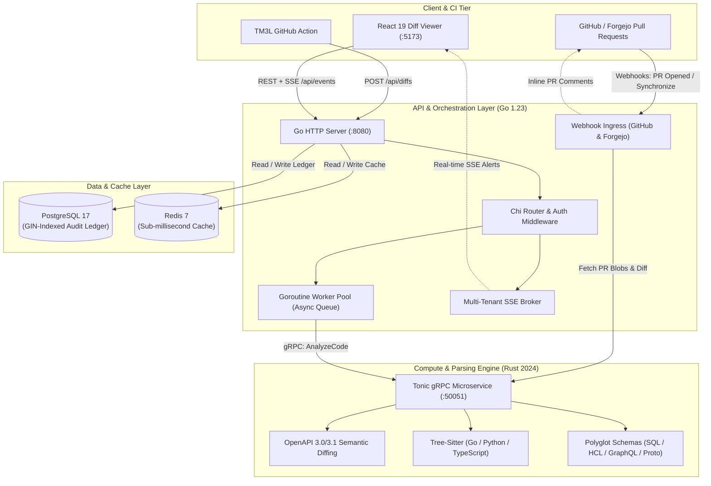

# 🔍 tm3l-break-detector

> **Enterprise Reference Architecture: Polyglot Contract & AST Change Governance Microservice Mesh**

[](LICENSE)
[](go.mod)
[](engine/Cargo.toml)
[](proto/analyzer.proto)
[](compose.yaml)
[](compose.yaml)
[](viewer/package.json)

---

## 🌟 Overview

Every engineering team has been burned by an undetected breaking change in production—a renamed schema field, a dropped database column, an added required query parameter, or an incompatible runtime dependency.

**`tm3l-break-detector`** is an **enterprise reference architecture** designed to solve cross-service contract breakage. It provides a production-grade blueprint for orchestrating polyglot static analysis engines, persistent gRPC microservices, asynchronous worker pools, immutable audit ledgers, and real-time developer dashboards.

---

## 📊 System Architecture



---

## 🛠️ Key Architectural Patterns & Design Decisions

### 1. Zero Remote-Code-Execution (RCE) Guarantee ([ADR-011](docs/adr/ADR-011-AST-Driven-Prompt-Synthesis.md))
The engine strictly analyzes syntax trees and specifications via read-only parsing (`tree-sitter` and `openapiv3`). Untrusted user code is **never compiled or executed** on the servers, eliminating RCE vulnerabilities while scaling horizontally with near-zero compute footprint.

### 2. High-Performance Persistent gRPC Microservice ([ADR-014](docs/adr/ADR-014-Rust-gRPC-Microservice.md))
To eliminate process startup penalties (`exec.Command`), the Rust parsing engine runs as a long-running [Tonic](https://github.com/hyperium/tonic) gRPC server over port `50051`, communicating with the Go orchestrator through strongly typed Protocol Buffers contracts ([`proto/analyzer.proto`](proto/analyzer.proto)).

### 3. Non-Blocking Async Ingress & Worker Pools ([ADR-012](docs/adr/ADR-012-Enterprise-Scalability-Refactor.md))
Incoming CI diff payloads are saved to staging buffers and enqueued onto a buffered Go channel (`chan DiffJob`). The HTTP ingress immediately yields `202 Accepted`, allowing a dedicated pool of worker goroutines to process AST diffs without blocking web server threads.

### 4. Immutable Non-Repudiation Audit Ledger
Every diff run is permanently persisted in PostgreSQL 17 with GIN indexing on raw JSONB diff payloads. When an engineer overrides a detected breaking change, a cryptographically tracked record is stored alongside their identity claims, creating a compliance-ready paper trail for SOC2 and ISO 27001 change control.

### 5. Multi-Tenant Server-Sent Events (SSE) Pub/Sub
The real-time broker isolates notification streams by `project_id` using a mutex-guarded client channel map (`map[string]map[chan []byte]bool`), preventing event leaks across distinct enterprise projects.

### 6. Omni-Git Webhook Automation ([PDR-003](docs/pdr/PDR-003-Omni-Git-Integrations.md))
Native webhook receivers parse GitHub and Forgejo `pull_request` payloads, autonomously fetch changed files via Git REST APIs, run static AST inspection, and post structured Markdown feedback comments directly onto the pull request.

### 7. AST-Driven Deterministic Prompt Compiler ([ADR-011](docs/adr/ADR-011-AST-Driven-Prompt-Synthesis.md))
Extracts structural code facts (imports, entrypoints, C-extension dependencies, and sensitive system calls) and deterministically synthesizes LLM system prompts for generating multi-stage Dockerfiles, standalone build scripts, GitHub Actions, and Kubernetes specs.

---

## 📦 Tech Stack

| Component | Technology | Rationale |
| :--- | :--- | :--- |
| **Parsing Engine** | Rust 2024 (`tree-sitter`, `openapiv3`, `tonic`) | Memory safety, deterministic AST evaluation, sub-millisecond parsing speed |
| **API & Orchestrator** | Go 1.23 (`chi`, `jwt-go`, `grpc-go`, `log/slog`) | Concurrent worker pools, lightweight HTTP routing, static compilation (`CGO_ENABLED=0`) |
| **Database** | PostgreSQL 17 (`lib/pq`) | ACID compliance, GIN JSONB indexing for deep AST queries, immutable audit logs |
| **Caching** | Redis 7 (`go-redis/v9`) | Sub-millisecond retrieval of cached diff runs and postmortems |
| **Frontend Viewer** | React 19, TypeScript, Vite 6, Tailwind CSS | Monaco DiffEditor side-by-side spec comparison, live SSE monitors, and audit ledger UI |
| **CI/CD Action** | Docker-based GitHub Action (`action/`) | Zero-configuration drop-in CI gatekeeper with `$GITHUB_STEP_SUMMARY` reporting |

---

## 📂 Repository Structure

```
├── action/              # Reusable Docker GitHub Action & entrypoint
├── cmd/server/          # Go API server entrypoint
├── deploy/              # Production Dockerfiles (Engine, Server, Viewer) & K8s specs
├── engine/              # Rust Tonic gRPC microservice & Tree-Sitter parsers
│   ├── src/analyzer.rs  # AST static fact & system call extractor
│   ├── src/code_diff.rs # Multi-language code migration checks (Py/Go/TS)
│   ├── src/diff.rs      # OpenAPI 3.0/3.1 semantic diffing
│   ├── src/sql.rs       # SQL migration destructive operation detector
│   ├── src/terraform.rs # Terraform stateful resource deletion scanner
│   ├── src/graphql.rs   # GraphQL schema breaking changes
│   └── src/protobuf.rs  # Protobuf tag & field deletion checks
├── internal/
│   ├── analyzer/        # Go gRPC client bridge and prompt synthesis engine
│   ├── api/             # Chi HTTP handlers, worker pool, SSE broker, webhooks
│   ├── db/              # PostgreSQL store & Redis caching client
│   └── models/          # Shared domain models and IPC structs
├── proto/               # Protocol Buffers definitions (analyzer.proto)
├── migrations/          # PostgreSQL database migration scripts
├── viewer/              # React 19 + Monaco DiffEditor frontend dashboard
└── docs/                # TM3L 11-Tier Decision Lifecycle Taxonomy (ADRs, PDRs, UXRs)
```

---

## 🚀 Local Development & Verification

### Run Unit Tests
```bash
# Run Go unit tests
go test -v ./internal/...

# Run Rust engine tests
cd engine && cargo test
```

### Build Binaries
```bash
# Build Go server
go build -o bin/server ./cmd/server

# Build Rust engine
cd engine && cargo build --release
```

### Full Mesh Orchestration (Docker Compose)
To run the full multi-service mesh locally with PostgreSQL, Redis, gRPC Engine, Go API, and React Viewer:
```bash
docker compose up --build
```
* **React Viewer**: `http://localhost:5173`
* **Go API**: `http://localhost:8081` (internal `8080`)
* **Rust gRPC Engine**: `localhost:50051`
* **PostgreSQL**: `localhost:5432`
* **Redis**: `localhost:6379`

---

## 📜 Formal Architecture & Decision Records

This repository strictly adheres to the **TM3L 11-Tier Decision Lifecycle Taxonomy**:

* **[ADR-011: AST-Driven LLM Prompt Synthesis](docs/adr/ADR-011-AST-Driven-Prompt-Synthesis.md)**
* **[ADR-012: Enterprise Scalability & Security Refactor](docs/adr/ADR-012-Enterprise-Scalability-Refactor.md)**
* **[ADR-013: Introduce Redis Caching for Break Detection](docs/adr/ADR-013-Redis-Caching.md)**
* **[ADR-014: Migrate Rust Engine to gRPC Microservice](docs/adr/ADR-014-Rust-gRPC-Microservice.md)**
* **[PDR-003: Omni-Git Integrations (GitHub App & Forgejo Webhooks)](docs/pdr/PDR-003-Omni-Git-Integrations.md)**
* **[PDR-004: Polyglot Schema Analysis Engine](docs/pdr/PDR-004-Polyglot-Schema-Analysis.md)**

---

## 📄 License
Licensed under the [MIT License](LICENSE).
