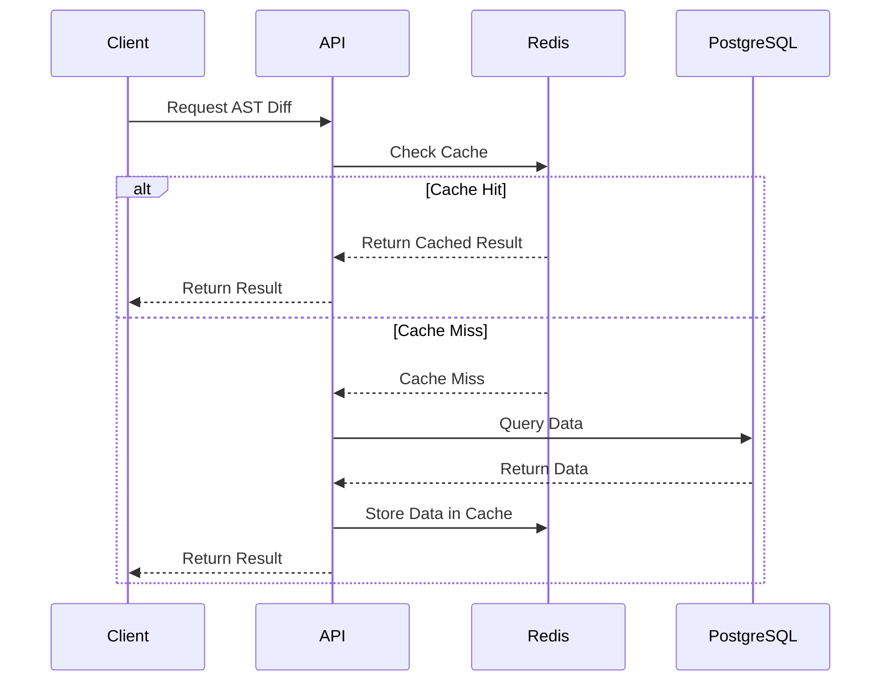

# ADR 013: Introduce Redis Caching for Break Detection

## 1. Context & Problem Statement
Currently, our Break Detector engine queries the PostgreSQL database for every AST diffing and postmortem analysis operation. As the user base has scaled, we've observed a significant increase in query latency, particularly during peak load when many concurrent repository scans occur. This constant database polling is creating a bottleneck, leading to degraded performance and increased response times for live operations. The problem is exacerbated by the fact that many of the analyzed AST structures and their corresponding metadata rarely change between subsequent commits. We need a way to reduce database load and improve response times for frequently requested static analysis results.

## 2. Decision Options & Alternatives Considered
1. **Vertical Scaling of PostgreSQL Database:** Increase the compute and memory resources of the primary PostgreSQL instance to handle the increased read load.
2. **Read Replicas:** Introduce PostgreSQL read replicas to distribute the read queries across multiple nodes.
3. **In-Memory Caching with Redis:** Implement Redis as an in-memory caching layer to store frequently accessed AST diffs and postmortem reports, reducing direct database reads.
4. **Application-Level In-Memory Cache (e.g., Go `sync.Map`):** Use an embedded cache within the application nodes.

## 3. Selected Decision
We have selected **Option 3: In-Memory Caching with Redis**.

Redis provides a distributed, fast, and scalable in-memory data store that perfectly fits our requirement to cache AST analysis results across multiple application instances. Unlike a simple in-memory map, Redis ensures cache consistency across all horizontal application pods. While read replicas would help, they are more complex to manage and do not offer the sub-millisecond latency that Redis provides for retrieving serialized AST structures.

## 4. Consequences & Trade-offs
**Positive Consequences:**
* Drastically reduced load on the primary PostgreSQL database.
* Sub-millisecond latency for fetching cached AST results, improving overall system throughput.
* Better scalability for horizontal application nodes accessing shared cache state.

**Negative Consequences (Trade-offs):**
* Increased infrastructure complexity due to managing a new Redis cluster.
* Potential issues with cache invalidation (stale data if not evicted correctly when underlying AST data changes).
* Additional operational overhead for monitoring Redis memory usage and eviction policies.
