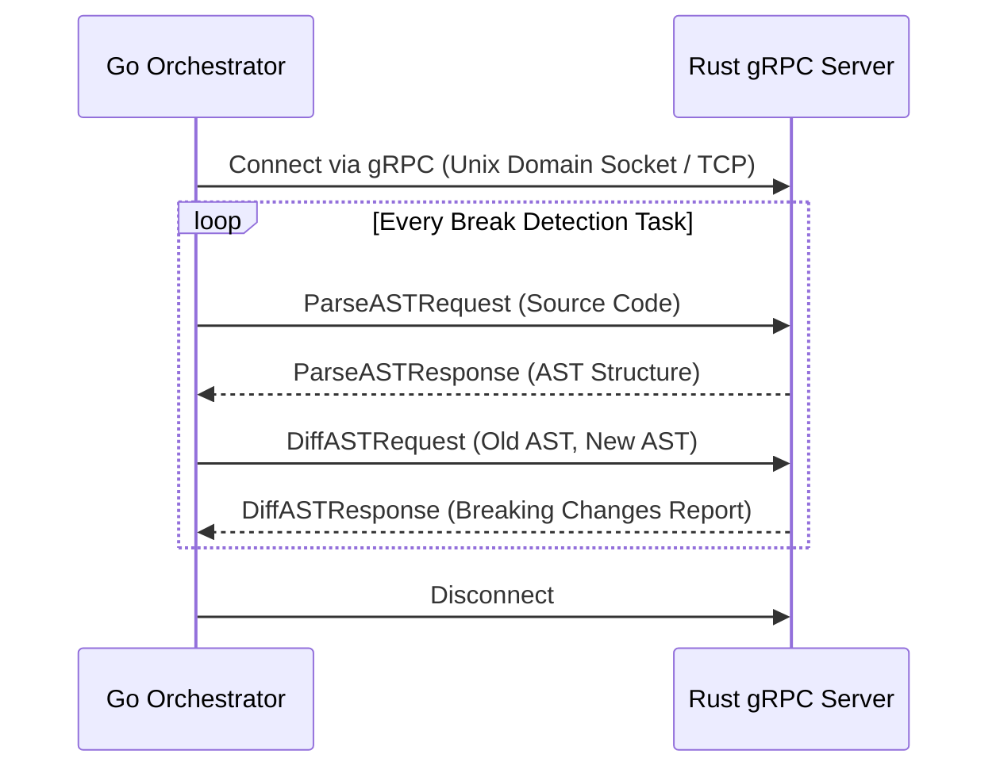

# ADR-014: Migrate Rust Engine to gRPC Microservice

## 1. Context & Problem Statement
The TM3L Break Detector utilizes a highly optimized Rust engine for memory-safe, high-performance Abstract Syntax Tree (AST) parsing and diffing. Currently, the Go orchestration backend invokes this Rust engine as a standalone CLI binary via Go's `exec.Command`. While this architectural approach provided a rapid initial integration path, it has introduced significant process invocation overhead. Specifically, constantly spinning up and tearing down the CLI process for every individual AST chunk or diff request incurs a substantial penalty in execution time. Additionally, process-based interaction forces data exchange through standard input/output streams and basic exit codes, which restricts complex structured data communication and complicates error handling. The core problem is how to eliminate the latency of repeated process creation and enable rich, typed, and resilient data exchange between the Go orchestrator and the Rust parsing engine.

## 2. Decision Options & Alternatives Considered
We evaluated several architectural approaches for integrating the Go orchestrator with the Rust engine:

*   **Option A: Retain CLI Execution via `exec.Command`**
    *   *Pros:* No changes required; completely decoupled failure domains.
    *   *Cons:* Unacceptable process invocation latency; rudimentary unstructured communication; difficult to trace and profile across boundaries.
*   **Option B: CGO bindings and Shared Libraries**
    *   *Pros:* Extremely low latency through in-process memory sharing.
    *   *Cons:* Compromises Go's static compilation (`CGO_ENABLED=0`); complicates the build matrix; increases the risk of memory corruption affecting the entire backend; difficult cross-compilation.
*   **Option C: Persistent gRPC Microservice**
    *   *Pros:* Eliminates process startup latency; strongly typed interfaces via Protocol Buffers; robust error handling; language-agnostic integration; allows independent scaling of the parsing engine.
    *   *Cons:* Introduces network communication overhead (even if over loopback or Unix domain sockets); requires maintaining protobuf definitions.

## 3. Selected Decision
We have decided to proceed with **Option C: Persistent gRPC Microservice**. The Rust Break Detector Engine will be migrated from a transient CLI binary into a persistent, continuously running gRPC server. The Go backend will act as a gRPC client, communicating with the Rust engine over a local network interface or Unix domain socket. Protocol Buffers will define the strict contracts for AST diffing requests and responses. This approach satisfies our static compilation requirements (`CGO_ENABLED=0`), completely resolves the process instantiation bottlenecks, and provides a mature, strongly typed communication channel suitable for our high-throughput AST analysis workload.

## 4. Consequences & Trade-offs
Migrating to a gRPC microservice architecture carries several consequences. On the positive side, we expect a dramatic reduction in end-to-end latency for high-volume analysis due to the persistent nature of the engine. The typed protobuf contracts will drastically reduce serialization errors and simplify future extensions of the AST diffing API. However, this decision introduces operational complexity. The deployment model now involves orchestrating two distinct long-running services rather than a single Go binary that bundles a CLI tool. We must implement resilient connection pooling and retry logic in the Go client to handle potential Rust server restarts. Furthermore, we must establish a unified build and schema management pipeline to ensure the Go and Rust protobuf generated code remains strictly synchronized.
