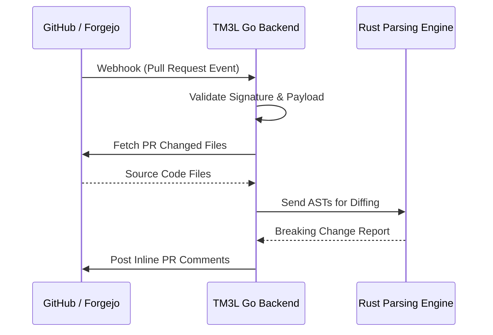

# PDR-003: Omni-Git Integrations (GitHub App & Forgejo Webhooks)

## 1. Context & Problem Statement

Currently, the TM3L Break Detector relies on generic Continuous Integration (CI) pipeline scripts to analyze pull requests and report breaking changes in Abstract Syntax Trees (AST). This approach is highly decoupled but introduces significant friction for end-users who must manually configure CI workflows, handle authentication tokens securely, and parse standard output into meaningful code review comments. Our product goal is to provide a seamless, zero-configuration experience for developers. The problem is how to best integrate the Break Detector directly into code hosting platforms to automatically fetch pull request files and post inline review comments when breaking changes are detected, minimizing user setup time and cognitive load.

## 2. Decision Options & Alternatives Considered

*   **Option A: Rely strictly on CI pipeline scripts (e.g., GitHub Actions, GitLab CI).** This requires no new backend development but forces users to maintain complex YAML configurations and prevents us from having deep, platform-specific integrations like inline PR comments without complex third-party action wrappers.
*   **Option B: Build a standalone integration microservice.** Creating a separate service in Python or Node.js to bridge the Go backend with GitHub and Forgejo allows for separation of concerns. However, it increases deployment complexity, operational overhead, and infrastructure costs by requiring the maintenance of multiple distinct services.
*   **Option C: Build native integrations directly into the existing Go backend.** This monolithic approach leverages Go's strong concurrency and standard HTTP library to handle webhook payloads and API communication efficiently, reducing deployment complexity while offering a premium, deeply integrated user experience.

## 3. Selected Decision

We have selected **Option C**: to build native GitHub App and Forgejo Webhook integrations directly into the Go backend. 

The Break Detector will autonomously receive webhook events for pull requests, fetch the changed files using the respective platform APIs, perform the AST parsing and breaking change detection via our Rust engine, and finally post inline review comments directly on the pull request. This approach provides the most cohesive product experience, drastically reducing onboarding friction for teams. By embedding this functionality in the Go orchestration layer, we maintain a single deployable binary, adhering to our backend architectural principles while delivering a highly responsive, native integration for both major enterprise Git platforms and self-hosted environments.

## 4. Consequences & Trade-offs

This decision carries several consequences. Positively, it significantly enhances the user experience by providing out-of-the-box, zero-configuration PR reviews, positioning TM3L as a first-class citizen on GitHub and Forgejo. 

However, the trade-offs include an increased scope of responsibility for the Go backend, which must now handle complex API rate limiting, webhook signature validation, and payload parsing for multiple distinct platforms. It will require ongoing maintenance as GitHub and Forgejo evolve their respective APIs. Additionally, we must carefully manage authentication state and secure credential storage for the GitHub App integration, requiring robust security measures within our deployment architecture.
