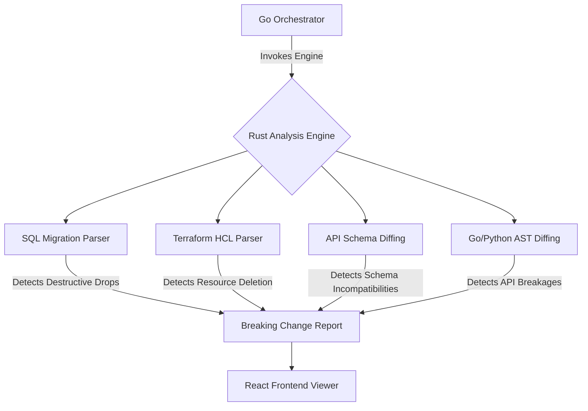

# PDR-004: Polyglot Schema Analysis Engine

## 1. Context & Problem Statement

The TM3L Break Detector currently focuses on abstract syntax tree (AST) parsing and breaking change detection for a limited set of programming languages. However, our system's users increasingly deploy complex architectures where breaking changes are not confined to source code. Changes to database schemas, infrastructure as code (IaC), API definitions, and deep semantic behaviors across different ecosystems introduce significant operational risks that are currently invisible to our static analysis tools. 

To provide comprehensive safety nets, our users need the detector to understand structural and behavioral changes across multiple new verticals. Specifically, we need to extend the detector to safely identify destructive database operations, stateful resource deletions in infrastructure, backward-incompatible API changes, and semantic breakages in diverse languages like Go and Python.

## 2. Decision Options & Alternatives Considered

We considered several approaches to address this requirement:

1.  **Multiple Domain-Specific Engines**: Build or integrate separate tools for each vertical (e.g., using a dedicated Terraform scanner, a separate SQL linter, and distinct AST analyzers for Go/Python). While this leverages specialized tools, it fragments our architecture, creates a disjointed user experience, and multiplies maintenance efforts.
2.  **Unified Rust Analysis Engine Expansion**: Extend our existing memory-safe Rust parsing engine to support these new verticals natively. This approach centralizes the parsing logic, leverages our existing high-performance architecture, and provides a unified interface for the Go backend and React frontend.
3.  **Third-Party API Integration**: Offload schema analysis to external SaaS platforms. This would quickly add capabilities but compromises our security posture (requiring source code transmission) and goes against our core value of providing local, statically compiled tooling.

## 3. Selected Decision

We have decided to proceed with **Option 2: Unified Rust Analysis Engine Expansion**. 

We will expand the existing Rust analysis engine to support four new verticals:
*   **Database SQL Migrations**: We will implement parsers to detect destructive SQL commands, such as `DROP TABLE`, `DROP COLUMN`, and unmitigated `ALTER` statements that could lead to data loss during migrations.
*   **Infrastructure as Code (Terraform)**: We will add capabilities to parse HCL (HashiCorp Configuration Language) to identify stateful resource deletions, particularly targeting databases, storage buckets, and identity management configurations.
*   **GraphQL and Protobuf Schemas**: The engine will be updated to diff API definitions, alerting users to backward-incompatible changes like removing fields, changing types, or altering required constraints.
*   **Deep Semantic Code AST Diffing (Go/Python)**: We will incorporate comprehensive semantic analysis for Go and Python, going beyond basic syntax to detect changes in exported interfaces, function signatures, and package structures that break downstream consumers.

## 4. Consequences & Trade-offs

This decision carries several implications for our development lifecycle and architecture. Extending the Rust engine will require a significant initial engineering investment to build and optimize new parsers, increasing the immediate workload on the core team. Furthermore, maintaining custom parsers for complex ecosystems like Terraform and Protobuf means we must closely monitor these technologies for syntax updates. 

However, the long-term benefits outweigh these costs. By centralizing the analysis logic in Rust, we maintain the high performance and memory safety our users expect. The unified engine simplifies our Go orchestrator's integration surface and provides a cohesive data model for the React frontend. Ultimately, this expansion positions TM3L as a holistic safety tool capable of securing the entire software delivery pipeline, significantly reducing the risk of production outages caused by disparate, undetected breaking changes.
